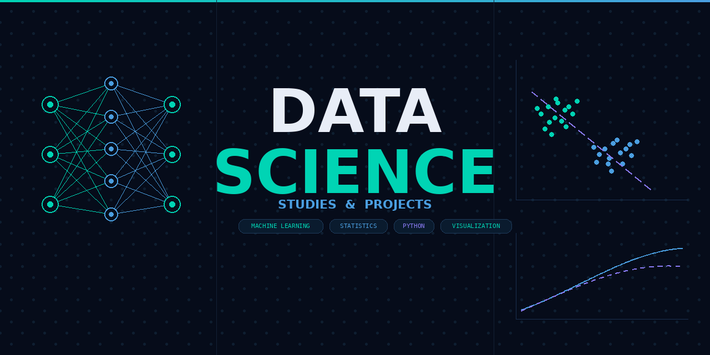

# thinkatlas

Bem-vindo ao ThinkAtlas, aqui jaz toda a minha revisão de tópicos da área de Data Science. Eu
pedi para a IA da `Anthropic`, o `Claude`, criar um plano de estudos personalizado que me faça
relembrar todos os tópicos importantes para essa jornada. Junto a esses exercícios, também estou
colocando em prática os exercícios propostos no `Clube Núcleo` do `Dr. Petrus`. Planejo também,
em cursos e estudos posteriores, também imortalizá-los aqui